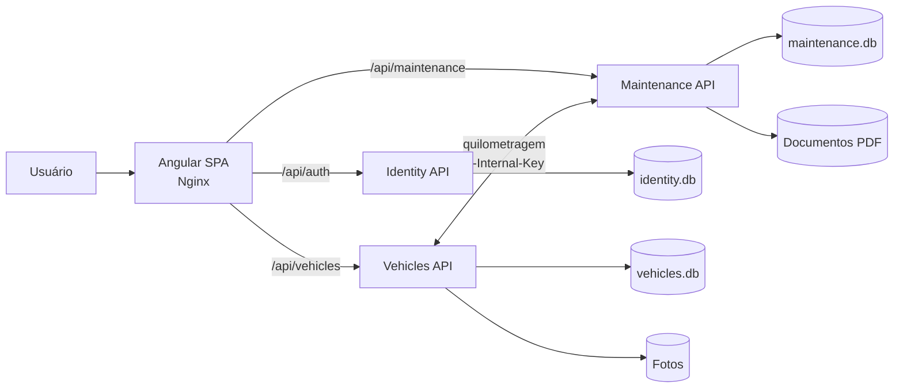

# Garagem em Dia

Aplicação web full stack para centralizar os cuidados de veículos particulares: cadastro do carro, histórico de serviços, alertas de manutenção por quilometragem, documentos fiscais e cálculo de consumo de combustível.

O projeto foi construído como um MVP mobile-first e, ao mesmo tempo, como demonstração de conhecimentos em arquitetura distribuída, modelagem de domínio, APIs protegidas, integração entre serviços, persistência de dados, formulários reativos e conteinerização.

Consulte [SECURITY.md](SECURITY.md) para o checklist de segurança, provisionamento de secrets, HTTPS, rotação e pendências de homologação em produção.

## Visão geral

O sistema é composto por uma SPA em Angular e três APIs independentes em ASP.NET Core. Cada serviço de back-end é responsável por um contexto de negócio, possui seu próprio banco SQLite e está dividido em camadas inspiradas em Clean Architecture.



### Contextos do back-end

| Serviço         | Responsabilidade                                                   |                                         Acesso Docker | Persistência                            |
| --------------- | ------------------------------------------------------------------ | ----------------------------------------------------: | --------------------------------------- |
| **Identity**    | Cadastro, login, emissão de JWT e recuperação de senha             |                                  Rede interna, `8080` | `identity.db`                           |
| **Vehicles**    | Cadastro e edição de veículos, hodômetro e upload de fotos         |                                  Rede interna, `8080` | `vehicles.db` + volume de imagens       |
| **Maintenance** | Alertas, recorrência, histórico de serviços, PDFs e abastecimentos |                                  Rede interna, `8080` | `maintenance.db` + volume de documentos |
| **Web**         | Interface Angular e proxy reverso Nginx                            | `443` em produção; loopback `4200` em desenvolvimento | —                                       |

## Funcionalidades

- Perfil do veículo em `/veiculos/:vehicleId`, com componentes independentes para custo por km e custo de manutenção.
- Filtros de mês inicial/final em cada gráfico, totais mensais e gastos de manutenção por categoria.
- Novas manutenções exigem data de realização, categoria e valor total dos serviços (zero é permitido para serviços sem custo). Abastecimentos exigem data e valor total pago positivo.
- O custo por km considera somente combustível: soma dos valores abastecidos dividida pela soma das distâncias dos lançamentos selecionados. Consumo e preço por litro usam totais ponderados, evitando a média simples de médias arredondadas. O lançamento inteiro pertence ao mês da data informada.
- Na inicialização, Maintenance atualiza automaticamente o SQLite existente, preservando os registros antigos. Data e custo desconhecidos permanecem nulos e são sinalizados nos gráficos; não são inferidos pela data de cadastro nem convertidos em gasto zero.

- Perfil do veículo em `/veiculos/:vehicleId`, com componentes independentes para custo por km e custo de manutenção.
- Filtros de mês inicial/final em cada gráfico, totais mensais e gastos de manutenção por categoria.
- Novas manutenções exigem data de realização, categoria e valor total dos serviços (zero é permitido para serviços sem custo). Abastecimentos exigem data e valor total pago positivo.
- O custo por km considera somente combustível: soma dos valores abastecidos dividida pela soma das distâncias dos lançamentos selecionados. Consumo e preço por litro usam totais ponderados, evitando a média simples de médias arredondadas. O lançamento inteiro pertence ao mês da data informada.
- Na inicialização, Maintenance atualiza automaticamente o SQLite existente, preservando os registros antigos. Data e custo desconhecidos permanecem nulos e são sinalizados nos gráficos; não são inferidos pela data de cadastro nem convertidos em gasto zero.

- Cadastro e autenticação de usuários com sessão baseada em JWT.
- Recuperação de senha por token temporário, de uso único, enviado por SMTP ou registrado no log em desenvolvimento.
- Cadastro e edição de veículos com modelo, ano, placa, cor, motorização, quilometragem e foto.
- Validação de hodômetro crescente para preservar a consistência do histórico.
- Criação de alertas de manutenção com antecedência configurável por quilometragem.
- Classificação de alertas em `warning` (próximo do vencimento) e `error` (vencido).
- Manutenções recorrentes: ao concluir um item, o próximo agendamento é criado automaticamente.
- Registro do histórico de serviços com descrição, quilometragem e nota fiscal em PDF.
- Download protegido dos documentos pertencentes ao usuário autenticado.
- Registro de abastecimentos e cálculo de rendimento em km/l.
- Rascunho local do formulário de abastecimento, separado por usuário.
- Dashboard com total de veículos, quilometragem acumulada e alertas ativos.

## Arquitetura

### Back-end: serviços e camadas

Cada contexto (`Identity`, `Vehicles` e `Maintenance`) é uma unidade independente dentro da solução .NET e contém quatro projetos:

```text
CarCare.<Contexto>.Api
    ↓ composição e uso
CarCare.<Contexto>.Application ← CarCare.<Contexto>.Persistence
    ↓ contratos e casos de uso             ↓ implementações
CarCare.<Contexto>.Domain             Entity Framework Core / integrações
```

- **Domain**: entidades, invariantes e comportamentos centrais, sem dependências de infraestrutura.
- **Application**: casos de uso, DTOs e contratos de repositórios ou serviços externos.
- **Persistence**: `DbContext`, mapeamentos do Entity Framework Core, repositórios e adaptadores HTTP/SMTP/JWT.
- **Api**: composição de dependências, autenticação, tratamento de erros e endpoints HTTP com Minimal APIs.

As interfaces de persistência e integração são declaradas na camada `Application`. A infraestrutura as implementa e é injetada em tempo de execução, mantendo as regras de negócio desacopladas do banco e do transporte.

Cada microsserviço é dono de seus dados. Não existem chaves estrangeiras entre bancos: a associação entre contextos ocorre por identificadores (`UserId` e `VehicleId`) e por chamadas HTTP internas.

### Comunicação entre Vehicles e Maintenance

Os serviços trocam atualizações de hodômetro por endpoints internos protegidos pelo cabeçalho `X-Internal-Key`:

1. Ao criar ou editar um veículo, `Vehicles` publica sua quilometragem para `Maintenance`.
2. Essa publicação é tolerante a falhas: indisponibilidade temporária de `Maintenance` gera um warning no log sem desfazer a operação do veículo.
3. Ao registrar um abastecimento ou serviço, `Maintenance` atualiza o hodômetro oficial em `Vehicles`.
4. Depois da confirmação, `Maintenance` atualiza sua projeção local de quilometragem, usada no cálculo dos alertas.

Essa estratégia reduz acoplamento de dados e demonstra dois comportamentos de consistência adequados a cada fluxo: sincronização best-effort na publicação e confirmação síncrona nas operações que dependem da validade do veículo.

### Front-end

A interface usa componentes Angular standalone, roteamento com lazy loading e organização por responsabilidade:

- `core`: acesso às APIs, modelos, autenticação, interceptor JWT e guarda de rotas;
- `features`: páginas agrupadas por funcionalidade (`auth`, `dashboard`, `vehicles` e `maintenance`);
- `shared`: shell de navegação e componentes reutilizáveis de formulário e feedback;
- arquivos `*.component.ts`, `*.component.html` e `*.component.css` separados para todos os componentes.

O estado de autenticação é exposto com Angular Signals e restaurado por `/api/auth/session`. O JWT fica em cookie `HttpOnly`, `Secure` em produção e `SameSite=Strict`. Formulários reativos concentram validações de entrada, o interceptor adiciona o cabeçalho de proteção contra requisições entre sites e o `authGuard` protege as rotas privadas. Tailwind CSS e Flowbite fornecem a base visual responsiva.

Em desenvolvimento, o proxy do Angular distribui `/api/auth`, `/api/vehicles`, `/api/maintenance` e `/uploads` entre as APIs. Na imagem de produção, o Nginx assume o mesmo papel e também entrega a SPA com fallback para o roteador do cliente.

## Regras de negócio relevantes

- E-mail é normalizado e possui índice único; placas são normalizadas em letras maiúsculas e são únicas por usuário.
- Senhas precisam ter pelo menos oito caracteres e são armazenadas pelo `PasswordHasher` do ASP.NET Core.
- Tokens JWT usam RS256 com RSA de pelo menos 3072 bits, contêm a identidade do usuário e expiram em uma hora. Apenas Identity recebe a chave privada; a validação usa chaves públicas e permite rotação.
- Tokens de recuperação são aleatórios, persistidos somente como hash SHA-256, expiram em uma hora e não podem ser reutilizados.
- A quilometragem de um veículo nunca pode diminuir.
- Um alerta passa a ser exibido quando `quilometragem atual >= quilometragem prevista - antecedência`.
- Um alerta é considerado vencido quando a quilometragem atual alcança ou ultrapassa a prevista.
- PDFs são limitados a 10 MB e validados por extensão e assinatura `%PDF-`; imagens aceitam JPG, PNG ou WEBP de até 5 MB.
- Todas as consultas de negócio filtram os dados pelo identificador extraído do JWT.

## Tecnologias

### Back-end

- .NET 10 e C# com nullable reference types e warnings tratados como erros
- ASP.NET Core Minimal APIs
- Entity Framework Core 10
- SQLite com estratégia database-per-service
- JWT Bearer Authentication
- ASP.NET Core Identity `PasswordHasher`
- SMTP para recuperação de senha
- Health Checks e respostas padronizadas com Problem Details

### Front-end

- Angular 20 com componentes standalone e Signals
- TypeScript 5.9
- Angular Router, HttpClient e Reactive Forms
- RxJS 7.8
- Tailwind CSS 3.4
- Flowbite 3.1
- Nginx 1.27

### DevOps e qualidade

- Docker e Docker Compose
- Dockerfiles multi-stage para SDK/runtime .NET e build/servidor web
- Volumes nomeados para bancos, imagens e documentos
- Gerenciamento central das versões de pacotes NuGet
- CSharpier e Prettier para formatação consistente
- `.editorconfig` compartilhado
- Build Angular com hashing e limite de tamanho do bundle

## Estrutura do repositório

```text
.
├── backend/
│   ├── CarCare.sln
│   ├── Directory.Build.props          # Regras comuns dos projetos .NET
│   ├── Directory.Packages.props       # Versões NuGet centralizadas
│   ├── Dockerfile.identity
│   ├── Dockerfile.vehicles
│   ├── Dockerfile.maintenance
│   └── src/
│       ├── Identity/
│       │   ├── CarCare.Identity.Api/
│       │   ├── CarCare.Identity.Application/
│       │   ├── CarCare.Identity.Domain/
│       │   └── CarCare.Identity.Persistence/
│       ├── Vehicles/                   # Api, Application, Domain e Persistence
│       ├── Maintenance/                # Api, Application, Domain e Persistence
│       └── Shared/CarCare.Security/    # Secrets, JWT, cookies, CSRF e rate limiting
├── frontend/
│   ├── src/app/
│   │   ├── core/
│   │   ├── features/
│   │   └── shared/
│   ├── Dockerfile
│   ├── nginx.conf
│   ├── proxy.conf.json
│   └── package.json
├── docker-compose.yml
├── .env.example
└── .editorconfig
```

## Principais endpoints

Os endpoints de veículos e manutenção exigem sessão autenticada por cookie JWT. Alterações via `/api/*` exigem `X-CarCare-Request: 1` e uma origem compatível quando o cabeçalho `Origin` está presente. Os endpoints `/internal/*` exigem a chave interna e estão bloqueados no proxy público.

| Método | Endpoint                                 | Descrição                                    |
| ------ | ---------------------------------------- | -------------------------------------------- |
| `POST` | `/api/auth/register`                     | Cria usuário e retorna a sessão              |
| `POST` | `/api/auth/login`                        | Autentica e emite JWT                        |
| `POST` | `/api/auth/forgot-password`              | Solicita recuperação de senha                |
| `POST` | `/api/auth/reset-password`               | Redefine a senha com token válido            |
| `GET`  | `/api/auth/session`                      | Restaura a identidade da sessão autenticada  |
| `POST` | `/api/auth/logout`                       | Expira o cookie de sessão                    |
| `GET`  | `/api/vehicles/`                         | Lista os veículos do usuário                 |
| `POST` | `/api/vehicles/`                         | Cadastra um veículo                          |
| `PUT`  | `/api/vehicles/{id}`                     | Atualiza dados e hodômetro                   |
| `POST` | `/api/vehicles/{id}/photo`               | Envia a foto do veículo                      |
| `GET`  | `/api/maintenance/`                      | Lista manutenções, opcionalmente por veículo |
| `POST` | `/api/maintenance/`                      | Cria um alerta de manutenção                 |
| `POST` | `/api/maintenance/{id}/complete`         | Conclui a manutenção e agenda a recorrência  |
| `GET`  | `/api/maintenance/alerts`                | Calcula alertas ativos pela quilometragem    |
| `GET`  | `/api/maintenance/history/{vehicleId}`   | Lista o histórico de serviços                |
| `POST` | `/api/maintenance/history`               | Registra serviço e documento PDF             |
| `GET`  | `/api/maintenance/history/document/{id}` | Baixa um documento autorizado                |
| `POST` | `/api/maintenance/fuel`                  | Registra abastecimento e calcula km/l        |
| `GET`  | `/health`                                | Verifica a disponibilidade de cada API       |

## Como executar

### Pré-requisitos

- Docker Desktop com Docker Compose; ou
- .NET SDK 10 e Node.js 22 para desenvolvimento sem contêineres.

### Ambiente completo com Docker

1. Gere as chaves locais (uma vez; exige .NET SDK 10):

   ```powershell
   dotnet run --project backend/tools/CarCare.Provision -- secrets
   ```

2. O gerador cria arquivos restritos em `secrets/`, ignorados pelo Git. Nenhuma chave padrão é aceita. O arquivo de senha SMTP vazio é permitido somente em Development.

3. Construa e inicie os quatro serviços:

   ```powershell
   docker compose up --build
   ```

4. Acesse [http://localhost:4200](http://localhost:4200).

As APIs ficam privadas na rede Docker e são acessadas pelo Nginx. Os bancos, uploads e documentos permanecem em volumes nomeados após a parada dos contêineres.

Para encerrar:

```powershell
docker compose down
```

O comando acima preserva os volumes. O arquivo `docker-compose.override.yml` carrega automaticamente a configuração local de desenvolvimento, incluindo `FrontendUrl=http://localhost:4200`. Para produção, use explicitamente `-f docker-compose.yml -f docker-compose.production.yml`, certificado TLS e SMTP conforme [SECURITY.md](SECURITY.md); esse comando não carrega o override local.

### Desenvolvimento do front-end

Para hot reload com APIs executadas fora do Docker, configure os caminhos dos secrets (`Jwt__PublicKeyFile`, `Jwt__PrivateKeyFile` somente em Identity e `InternalApiKeyFile` nos outros serviços), `ASPNETCORE_ENVIRONMENT=Development`, `FrontendUrl=http://localhost:4200` e as URLs internas `Services__Vehicles`/`Services__Maintenance` para as portas locais `7002`/`7003`. Inicie as APIs em `7001`, `7002` e `7003`, conforme o proxy Angular, e execute:

```powershell
Set-Location frontend
npm install
npm start
```

O Angular CLI abre o servidor de desenvolvimento em `http://localhost:4200` e usa `proxy.conf.json` para evitar URLs de serviços espalhadas pelo código cliente.

### Build e validação

```powershell
# Back-end
dotnet restore backend/CarCare.sln
dotnet build backend/CarCare.sln

# Front-end
Set-Location frontend
npm install
npm run build
npm run format:check

# Cálculos dos gráficos: períodos, categorias, médias ponderadas e dados incompletos
npm run test:costs

# Cálculos dos gráficos: períodos, categorias, médias ponderadas e dados incompletos
npm run test:costs
```

Para restaurar e validar o formatador C#:

```powershell
Set-Location backend
dotnet tool restore
dotnet csharpier check .
```

Há uma suíte executável de verificações de segurança e integração das APIs: `dotnet run --project backend/tests/CarCare.Security.Checks -- --api-smoke backend`, executada da raiz após o build. Ainda não existe cobertura automatizada completa das regras de negócio e da interface.

## Configuração

| Variável                         | Uso                                                                                    |
| -------------------------------- | -------------------------------------------------------------------------------------- |
| `SECRETS_DIR`                    | Diretório protegido com par RSA, chave interna e senha SMTP                            |
| `SERVER_NAME`                    | Nome DNS público do Nginx                                                              |
| `TLS_CERT_FILE` / `TLS_KEY_FILE` | Caminhos de certificado de cadeia completa e chave TLS                                 |
| `FRONTEND_URL`                   | Origem usada para montar o link de redefinição de senha                                |
| `SMTP_HOST`                      | Servidor SMTP; obrigatório em produção. O fallback de log existe apenas em Development |
| `SMTP_PORT`                      | Porta SMTP, padrão `587`                                                               |
| `SMTP_USERNAME`                  | Usuário SMTP                                                                           |
| `secrets/smtp-password`          | Arquivo de senha SMTP montado como secret, não variável de ambiente                    |
| `SMTP_FROM`                      | Remetente das mensagens de recuperação                                                 |

As connection strings e URLs internas já são fornecidas pelo `docker-compose.yml`. Segredos são gerados por ambiente, montados como arquivos e validados na inicialização; não existem chaves padrão no repositório.

## Decisões e trade-offs do MVP

- **SQLite por serviço:** simplifica execução e demonstra isolamento de dados. Para maior volume e concorrência, cada banco pode evoluir independentemente para um SGBD gerenciado.
- **HTTP síncrono entre serviços:** mantém o MVP fácil de operar. Uma evolução natural seria usar mensageria, outbox e retentativas para garantir a entrega de eventos de hodômetro.
- **`EnsureCreated` no bootstrap:** reduz a configuração inicial. Em produção, migrations versionadas seriam preferíveis para evolução controlada do schema.
- **Arquivos em volumes locais:** atende ao ambiente conteinerizado atual. Object storage e URLs assinadas seriam adequados para implantação distribuída.
- **JWT em cookie protegido:** reduz exposição da sessão ao JavaScript e exige defesa contra CSRF. Tokens expiram em uma hora; revogação individual imediata continua sendo uma evolução futura.
- **Nginx como gateway leve:** centraliza o acesso da SPA às APIs sem introduzir um API Gateway dedicado nesta fase.

## Próximas evoluções

- Testes unitários para entidades e serviços de aplicação.
- Ampliar os testes de integração das APIs com bancos efêmeros para todas as regras de negócio.
- Migrations do Entity Framework Core e pipeline de CI.
- OpenAPI/Swagger e versionamento de endpoints.
- Mensageria para eventos entre os contextos.
- Paginação e filtros no histórico de serviços e abastecimentos.
- Observabilidade distribuída com métricas, tracing e correlação de logs.
- Deploy em nuvem com banco gerenciado e object storage.

## Conhecimentos demonstrados

Este projeto reúne práticas de desenvolvimento full stack com C# e Angular: desenho de domínios, separação de responsabilidades, Dependency Inversion, APIs REST, autenticação e autorização, validação em múltiplas camadas, consistência entre serviços, persistência relacional, upload seguro de arquivos, experiência responsiva, configuração por ambiente e empacotamento reproduzível com contêineres.
